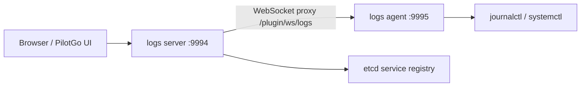

# PilotGo-plugin-logs

#### Description

PilotGo-plugin-logs is the host-logs plugin for [PilotGo](https://atomgit.com/openeuler/PilotGo). It lets you view and search systemd journal logs of managed hosts from the PilotGo platform. The plugin has two parts:

- **logs agent**: runs on each managed host and collects/stream logs via `journalctl` / `systemctl`.
- **logs server**: runs as the PilotGo plugin server, ships an embedded web UI, integrates with the PilotGo platform, handles service registration/discovery, and proxies browser requests to the corresponding agent.

> Requirement: the agent depends on systemd-journald and currently supports only **openEuler** and **Kylin** (detected via `/etc/system-release`).

#### Software Architecture

The plugin uses a separated agent / server design. The browser reaches the pages and APIs served by logs server through the PilotGo platform; logs server then proxies log queries over WebSocket to the logs agent on the target host, which runs `journalctl` and streams entries back.



Main directories:

| Directory | Description |
| --- | --- |
| `cmd/agent` | log collection agent, listens on `0.0.0.0:9995` by default |
| `cmd/server` | plugin server, listens on `0.0.0.0:9994` by default |
| `cmd/public` | message types and structs shared by agent and server |
| `web` | frontend source built with Vue3 + Element Plus + Vite |
| `scripts` | systemd unit files and the RPM `.spec` |

HTTP APIs (served by logs server under the PilotGo routes):

| Method & path | Description |
| --- | --- |
| `GET /plugin/logs/api/ip_list` | List target-host IPs available for log collection |
| `POST /plugin/logs/api/runcommand?type=install\|uninstall` | Remotely install / uninstall the logs agent on target hosts |
| `GET /plugin/ws/logs` | WebSocket log-stream proxy between browser and agent |

#### Installation

**Prerequisites**: Go 1.23+, Node.js 18+ (or npm), systemd; the server must be able to reach the etcd used by PilotGo.

**Option 1: RPM (recommended)**

```shell
# install the server
yum install -y PilotGo-plugin-logs-server
# install the agent on each host to collect logs from
yum install -y PilotGo-plugin-logs-agent
```

The RPM installs binaries and default configs under `/opt/PilotGo/plugin/logs/{server,agent}` and registers the systemd services `PilotGo-plugin-logs-server` and `PilotGo-plugin-logs-agent`.

**Option 2: Build from source**

```shell
# 1. build the frontend and copy artifacts into the server embedded-resource dir
cd web
npm install
npm run build
cd ..
cp -rf web/dist/* cmd/server/webserver/frontendResource/

# 2. build the server (-tags=production embeds the frontend assets)
cd cmd/server
GOWORK=off GO111MODULE=on go build -tags=production -o PilotGo-plugin-logs-server main.go

# 3. build the agent
cd ../agent
GOWORK=off GO111MODULE=on go build -o PilotGo-plugin-logs-agent main.go
```

#### Instructions

Both server and agent take a `-conf` flag pointing to the **configuration directory** (default `./`); the program looks for `logs_server.yaml` / `logs_agent.yaml` inside it. Copy the bundled templates to get started:

```shell
cp cmd/server/logs_server.yaml.template /opt/PilotGo/plugin/logs/server/logs_server.yaml
cp cmd/agent/logs_agent.yaml.template   /opt/PilotGo/plugin/logs/agent/logs_agent.yaml
```

Example config (`logs_server.yaml`):

```yaml
logs:
  https_enabled: false          # whether to enable TLS
  cert_file: ""                 # cert path when TLS is enabled
  key_file: ""                  # key path when TLS is enabled
  server_listen_addr: "0.0.0.0:9994"   # server listen address
  server_target_addr: "localhost:9994" # address used by remote clients to reach the plugin
log:
  level: debug
  driver: file                  # stdout: console; file: write to path
  path: /opt/PilotGo/plugin/logs/server/log/logs-server.log
  max_file: 1                   # max number of rotated log files
  max_size: 10485760            # max size of a single log file (bytes)
etcd:
  endpoints:
    - "localhost:2379"          # etcd address for service registration/discovery
  service_name: "logs-service"
  menu_name: "主机日志"          # menu name shown in the PilotGo platform
  icon: "Reading"
```

Run manually:

```shell
# start the server
./PilotGo-plugin-logs-server -conf /opt/PilotGo/plugin/logs/server
# start the agent
./PilotGo-plugin-logs-agent -conf /opt/PilotGo/plugin/logs/agent
```

Or manage via systemd:

```shell
systemctl start PilotGo-plugin-logs-server
systemctl start PilotGo-plugin-logs-agent
```

After startup, open the corresponding menu in the PilotGo platform (default "主机日志"), pick a target host, and view/search its journal logs in real time.

#### Contribution

1.  Fork the repository
2.  Create Feat_xxx branch
3.  Commit your code
4.  Create Pull Request

#### License

Licensed under [MulanPSL-2.0](LICENSE).
