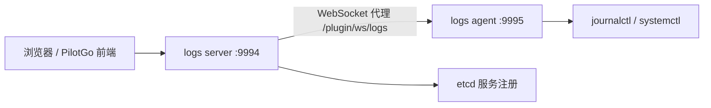

# PilotGo-plugin-logs

#### 介绍

PilotGo-plugin-logs 是 [PilotGo](https://atomgit.com/openeuler/PilotGo) 的主机日志插件，用于在 PilotGo 平台上集中查看、检索目标主机的 systemd journal 日志。插件由两部分组成：

- **logs agent**：部署在被纳管的目标主机上，调用 `journalctl` / `systemctl` 采集并实时推送日志。
- **logs server**：作为 PilotGo 的插件服务端运行，内置前端界面，负责对接 PilotGo 主平台、做服务注册与发现，并将浏览器请求代理转发到对应的 agent。

> 运行环境说明：agent 依赖 systemd-journald，目前仅支持 **openEuler** 与 **Kylin**（通过读取 `/etc/system-release` 判断）。

#### 软件架构

整体采用 agent / server 分离的结构：浏览器通过 PilotGo 主平台访问 logs server 提供的页面与接口，logs server 再通过 WebSocket 代理，把日志查询请求转发到目标主机上的 logs agent，由 agent 执行 `journalctl` 并流式回传日志。



主要目录：

| 目录 | 说明 |
| --- | --- |
| `cmd/agent` | 日志采集端（agent）源码，默认监听 `0.0.0.0:9995` |
| `cmd/server` | 插件服务端（server）源码，默认监听 `0.0.0.0:9994` |
| `cmd/public` | agent 与 server 共用的消息类型、结构体定义 |
| `web` | 基于 Vue3 + Element Plus + Vite 的前端源码 |
| `scripts` | systemd service 单元文件与 RPM 打包 `.spec` |

日志查询接口（由 logs server 提供，注册在 PilotGo 路由下）：

| 方法与路径 | 说明 |
| --- | --- |
| `GET /plugin/logs/api/ip_list` | 获取可采集日志的目标主机 IP 列表 |
| `POST /plugin/logs/api/runcommand?type=install\|uninstall` | 远程批量安装 / 卸载目标主机上的 logs agent |
| `GET /plugin/ws/logs` | 浏览器与 agent 之间的 WebSocket 日志流代理 |

#### 安装教程

**环境要求**：Go 1.23+、Node.js 18+（或 npm）、systemd；server 侧运行需可访问 PilotGo 使用的 etcd。

**方式一：通过 RPM 安装（推荐）**

```shell
# 安装 server 端
yum install -y PilotGo-plugin-logs-server
# 安装 agent 端（在需要采集日志的主机上）
yum install -y PilotGo-plugin-logs-agent
```

RPM 会将程序与默认配置安装到 `/opt/PilotGo/plugin/logs/{server,agent}`，并注册 systemd 服务 `PilotGo-plugin-logs-server` 与 `PilotGo-plugin-logs-agent`。

**方式二：源码构建**

```shell
# 1. 构建并部署前端（产物拷贝到 server 内嵌资源目录）
cd web
npm install
npm run build
cd ..
cp -rf web/dist/* cmd/server/webserver/frontendResource/

# 2. 构建 server（-tags=production 用于内嵌前端资源）
cd cmd/server
GOWORK=off GO111MODULE=on go build -tags=production -o PilotGo-plugin-logs-server main.go

# 3. 构建 agent
cd ../agent
GOWORK=off GO111MODULE=on go build -o PilotGo-plugin-logs-agent main.go
```

#### 使用说明

server 与 agent 均通过 `-conf` 参数指定**配置目录**（默认为 `./`），程序会在该目录下分别查找 `logs_server.yaml` / `logs_agent.yaml`。可直接从仓库内的 `*.yaml.template` 拷贝生成：

```shell
cp cmd/server/logs_server.yaml.template /opt/PilotGo/plugin/logs/server/logs_server.yaml
cp cmd/agent/logs_agent.yaml.template   /opt/PilotGo/plugin/logs/agent/logs_agent.yaml
```

配置项示例（`logs_server.yaml`）：

```yaml
logs:
  https_enabled: false          # 是否启用 TLS
  cert_file: ""                 # 启用 TLS 时的证书路径
  key_file: ""                  # 启用 TLS 时的私钥路径
  server_listen_addr: "0.0.0.0:9994"   # server 监听地址
  server_target_addr: "localhost:9994" # 远程客户端连接插件时使用的地址
log:
  level: debug
  driver: file                  # stdout 输出到终端；file 输出到 path 指定文件
  path: /opt/PilotGo/plugin/logs/server/log/logs-server.log
  max_file: 1                   # 最多保留的历史日志文件数
  max_size: 10485760            # 单个日志文件大小上限（字节）
etcd:
  endpoints:
    - "localhost:2379"          # etcd 地址，用于服务注册与发现
  service_name: "logs-service"
  menu_name: "主机日志"          # 在 PilotGo 平台中展示的菜单名称
  icon: "Reading"
```

手动运行：

```shell
# 启动 server
./PilotGo-plugin-logs-server -conf /opt/PilotGo/plugin/logs/server
# 启动 agent
./PilotGo-plugin-logs-agent -conf /opt/PilotGo/plugin/logs/agent
```

或通过 systemd 管理：

```shell
systemctl start PilotGo-plugin-logs-server
systemctl start PilotGo-plugin-logs-agent
```

启动后，在 PilotGo 平台对应菜单（默认“主机日志”）中选择目标主机，即可实时查看与检索该主机的 journal 日志。

#### 参与贡献

1.  Fork 本仓库
2.  新建 Feat_xxx 分支
3.  提交代码
4.  新建 Pull Request

#### 许可证

本项目基于 [MulanPSL-2.0](LICENSE) 许可。
